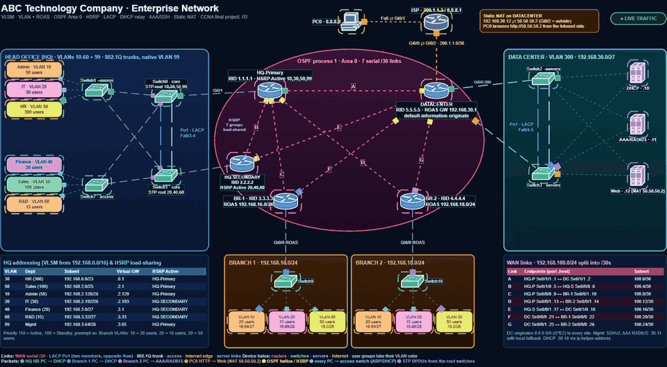

# 🌐 ABC Technology Company — Enterprise Network

**Design and implementation of a multi-site enterprise network in Cisco Packet Tracer**
VLSM · VLANs + ROAS · OSPF · HSRP · LACP · DHCP relay · AAA/RADIUS · SSHv2 · Static NAT

*Final project of the CCNA track at the Information Technology Institute (ITI)*

  

Live packet flows across the topology · <a href="assets/network-animation.mp4">full-quality MP4</a>

---

## 📌 Overview

A Head Office (HQ), two branches, a Data Center with shared services, and a simulated ISP, connected through an **OSPF Area 0** WAN of five routers and seven point-to-point serial links. The design removes single points of failure at the gateway layer (HSRP) and the switching layer (LACP EtherChannel).

| Site | Details |
|---|---|
| **HQ** | 6 departments + management VLAN, two routers (HQ-Primary / HQ-SECONDARY), two core + two access switches |
| **Branch 1 / 2** | 3 user groups each (50 / 20 / 10 users), one router and one switch per branch |
| **Data Center** | DHCP, AAA (RADIUS) and Web servers behind two switches joined by an EtherChannel |
| **Internet edge** | ISP router, external test PC `8.8.8.8`, Web server published through static NAT |

## 🎞️ Animated topology

The interactive diagram lives in [`diagrams/abc-network-topology.drawio`](diagrams/abc-network-topology.drawio). Colored dots show real traffic flows:

| Color | Flow |
|---|---|
| 🟢 Green | HQ HR PC → DHCP server (relay across the WAN) |
| 🟠 Orange | Internet PC0 → Web server through static NAT |
| 🔵 Blue | Branch 1 → DHCP server |
| 🟣 Purple | Branch 2 → AAA server |
| 🟡 Yellow | OSPF / HSRP control traffic |
| 🔷 Cyan | PC → access switch |
| 🟪 Violet | STP BPDUs |

> **How to view:** open the file at [app.diagrams.net](https://app.diagrams.net) (File → Open from → Device). The animation plays in the draw.io viewer; static exports (PNG/PDF) are frozen. Use a screen recording or GIF to share the motion.

Packet Tracer lab file: [`downloads/ABC-Network-FINAL.pkt`](downloads/ABC-Network-FINAL.pkt) (open with Cisco Packet Tracer)

Original Packet Tracer topology: [`diagrams/packet-tracer-topology.png`](diagrams/packet-tracer-topology.png)

## ✅ Requirements

| # | Requirement | Implementation |
|---|---|---|
| 1 | VLSM | Subnets sized per department from `192.168.0.0/16`, largest first (/23 → /30) |
| 2 | OSPF | Process 1, Area 0, five routers with unique router IDs, default route via `default-information originate` |
| 3 | VLANs + inter-VLAN routing | 802.1Q sub-interfaces (router-on-a-stick) on HQ-Primary, HQ-SECONDARY, BR-1, BR-2, DATACENTER |
| 4 | Standalone DHCP | Server `192.168.30.10`, 12 pools, `ip helper-address` on every user gateway |
| 5 | AAA + local admin | `aaa new-model`, local user `admin` (privilege 15), RADIUS server `192.168.30.11` with local fallback |
| 6 | Line password / enable secret | Configured on every router (values redacted in this repo) |
| 7 | Static NAT | `192.168.30.12` ↔ `50.50.50.2` on DATACENTER |
| 8 | EtherChannel | LACP Po1 on the HQ core pair and the Data Center pair |
| 9 | HSRP | One group per VLAN, load-shared (priority 110/100, preempt) |
| 10 | SSH | SSHv2 on all routers, Telnet disabled |

## 📚 Documentation

| Document | Content |
|---|---|
| [docs/01-addressing-plan.md](docs/01-addressing-plan.md) | VLSM tables, WAN links, DHCP pools |
| [docs/02-design-notes.md](docs/02-design-notes.md) | VLANs, trunks, EtherChannel, STP/HSRP alignment, OSPF, services |
| [docs/03-verification.md](docs/03-verification.md) | Verification commands and failure/redundancy tests |
| [configs/](configs/) | Sanitized configuration snippets |

Full report (26 pages, with screenshots): [docs/CCNA-Final-Project-Report.pdf](docs/CCNA-Final-Project-Report.pdf)

## 🛠️ Tech stack

Cisco Packet Tracer · Cisco IOS · draw.io (mxGraph) · Markdown

## 👥 Team & credits

**Basel Mohamed** ([@Basel36](https://github.com/Basel36)) · Yousef Khaled · Abdelfatah Mohamed
Supervised by Eng. Hager Taha and Eng. Ekram Abdelwahab — Information Technology Institute (ITI)

## 🔒 Security note

Lab credentials are **not** included in the configs or docs. The `.pkt` file and the PDF report are the original lab artifacts and contain Packet Tracer lab values only. Configs use placeholders (`<LINE_PASSWORD>`, `<ENABLE_SECRET>`, `<ADMIN_SECRET>`, `<RADIUS_KEY>`). Never reuse lab values in production.

## 📄 License

[MIT](LICENSE)
